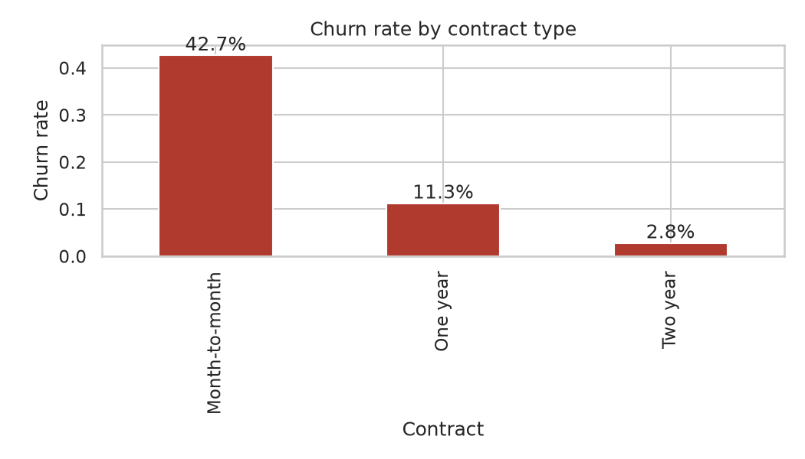
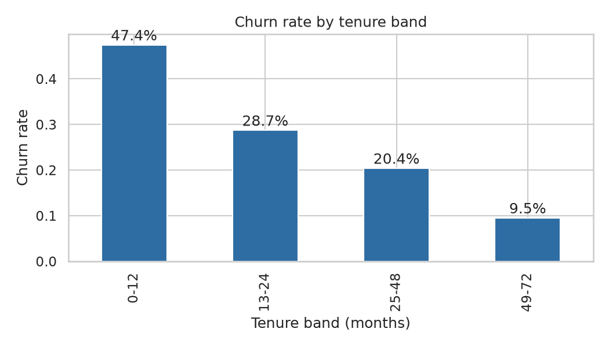
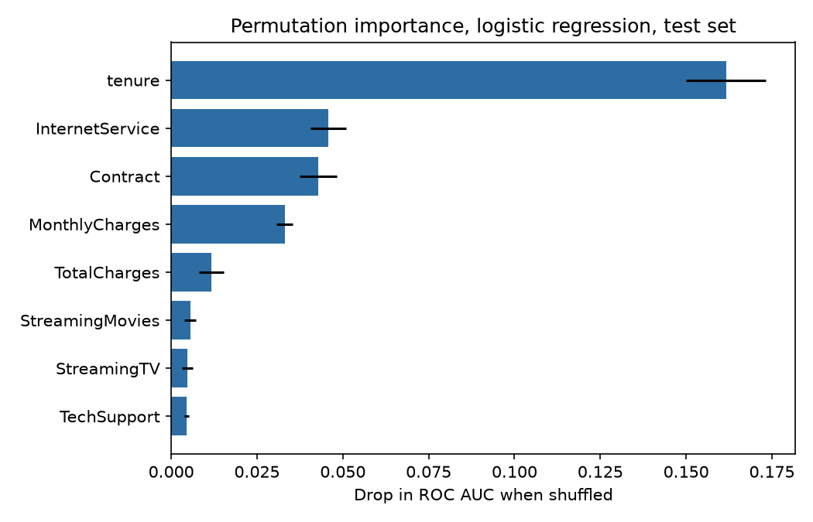

# Telco Customer Churn Analysis

An end-to-end churn analysis on the IBM Telco sample dataset: exploratory
analysis in notebooks, two models trained and compared on a held-out test
set, a short findings write-up for a business reader, and a Streamlit app
that scores a customer profile against the shipped model. Churn is 26.5
percent overall, concentrated in first-year, month-to-month accounts, and
the logistic regression that ships scores 0.846 ROC AUC on customers it
never saw in training.

Live app: https://telco-churn-analysis-t5rx.onrender.com (free tier, the first request after idle can take a minute)

## Problem

A telecom provider loses about a quarter of its customers in this dataset.
Retention work is usually spread across the whole base because nobody can
say which accounts are actually at risk. This project answers two
questions: which customers churn, in plain segment terms a retention team
can act on, and how well a model can rank accounts by risk so outreach
goes to the right list.

## Approach

- Clean the raw CSV once, in `src/churn/features.py`: TotalCharges arrives
  as text with blanks for brand new customers, SeniorCitizen arrives as
  0/1, and one feature is engineered (charges per month of tenure). The
  same module builds the scikit-learn preprocessing pipeline used by the
  notebooks, the training script, and the app, so there is one definition
  of the features everywhere.
- Explore segments before modeling: churn rate by contract, tenure band,
  internet service, add-ons, and payment method (`notebooks/01_eda.ipynb`).
- Train two models on a stratified 75/25 split (seed 42): logistic
  regression with scaled features, and a random forest on raw features.
  Both use class weights instead of resampling, so the training data keeps
  the real customer mix and the probabilities stay comparable.
- Judge the models on held-out customers with ROC AUC first, then look at
  precision and recall across thresholds, because the right threshold
  depends on the cost of a missed churner against the cost of a wasted
  offer.
- Rank drivers two ways, grouped permutation importance and SHAP, and only
  trust the drivers both methods agree on.

## Results

Dataset: 7,043 customers, 1,869 churners (26.5 percent). Test set: 1,761
customers, churn rate 26.5 percent.

| Model | ROC AUC | Accuracy | Precision | Recall | F1 |
| --- | --- | --- | --- | --- | --- |
| Logistic regression | 0.846 | 0.750 | 0.519 | 0.797 | 0.628 |
| Random forest | 0.839 | 0.786 | 0.593 | 0.619 | 0.606 |

The logistic regression ships, chosen on ROC AUC. The forest is more
precise and less useful for retention: it misses 38 percent of churners
at the default threshold. For the shipped model, moving the threshold to
0.30 lifts recall to 0.927 at precision 0.433, which is the working point
suggested for outreach lists. Full metrics, including the threshold sweep
and driver table, are in `reports/metrics.json` and reproduce exactly by
rerunning the training command below.

What drives churn, in segment terms:

- Contract: month-to-month churns at 42.7 percent, one year at 11.3
  percent, two year at 2.8 percent.
- Tenure: 47.4 percent of customers leave in their first 12 months, and
  first-year customers account for 55.5 percent of all churners.
- Payment: electronic check churns at 45.3 percent against 15.2 to 16.7
  percent for the two automatic methods.
- Add-ons: among internet customers, accounts without tech support churn
  at 41.6 percent against 15.2 percent with it; without online security,
  41.8 percent against 14.6 percent.
- Driver ranking (permutation importance, drop in test AUC): tenure
  0.162, InternetService 0.046, Contract 0.043, MonthlyCharges 0.033.
  SHAP on the same model gives the same top four in the same order.







## Tech stack

- Python 3.11 or newer
- pandas and numpy for data handling
- scikit-learn for pipelines, both models, and evaluation
- matplotlib and seaborn for figures
- SHAP for a second view of the drivers
- Streamlit for the scoring app
- joblib for the saved model bundle
- pytest and ruff for tests and lint
- Docker image that trains the model at build time and serves the app

## Key findings

The short version: churn is a first-year, month-to-month, electronic
check problem, and fiber accounts without support add-ons are the next
worst group. The full write-up, with segment tables, the worst combined
segments, five retention actions tied to the numbers, and the caveats,
is in [findings.md](findings.md).

## Run it locally

```bash
python -m venv .venv && source .venv/bin/activate
pip install -e ".[dev,app]"
```

Get the data (the CSV is also included in `data/raw/`; this script
re-downloads it and checks its SHA-256):

```bash
python data/get_data.py        # or: make data
```

Train and evaluate (writes `models/churn_model.joblib` and
`reports/metrics.json`):

```bash
python -m churn.train --data data/raw/telco_churn.csv    # or: make train
```

Notebooks, already executed with outputs in place:

```bash
jupyter nbconvert --to notebook --execute --inplace \
    notebooks/01_eda.ipynb notebooks/02_modeling.ipynb   # or: make notebooks
```

Score a customer profile in the app:

```bash
streamlit run app.py           # or: make app
```

Tests and lint, the same commands CI runs:

```bash
ruff check src tests data app.py
pytest -q
```

Or with Docker, which trains the model during the build and then serves
the app on port 8501:

```bash
docker build -t telco-churn-analysis .
docker run -p 8501:8501 telco-churn-analysis
```

## Project layout

```text
app.py                  Streamlit scoring app
data/get_data.py        Dataset download with checksum verification
data/raw/               The dataset CSV
notebooks/              01_eda.ipynb, 02_modeling.ipynb (executed)
src/churn/              features.py, train.py, evaluate.py
tests/                  Feature pipeline and training smoke tests
models/                 Trained model bundle (generated by training)
reports/metrics.json    Model metrics and driver table (generated)
reports/figures/        Figures used in the notebooks and this README
findings.md             Business findings and retention actions
Dockerfile              Image that trains, then serves the app
```

## Data note

The dataset is the IBM Telco Customer Churn sample, published by IBM in
the telco-customer-churn-on-icp4d repository for analysis and demos:
7,043 customers, 21 columns, one row per customer. The CSV is included
under `data/raw/` so every number in this repo reproduces offline;
`data/get_data.py` downloads the same file and verifies its SHA-256
(16320c9c1ec72448db59aa0a26a0b95401046bef5d02fd3aeb906448e3055e91).
Model and metrics files under `models/` and `reports/` are build
outputs and are not tracked in git; training regenerates them.

## Limitations

- The dataset is a published sample, not a live customer base. Segment
  rates are associations in a snapshot, and contract, payment, and
  add-on effects are partly self-selection. The findings say which
  effects need a pilot before anyone spends money on them.
- One row per customer means no behavior over time: no usage trends, no
  support ticket history, no price change events, all of which carry
  churn signal in a real system.
- The engineered feature set is small on purpose. charges_per_month adds
  little (permutation importance 0.002) and is kept as a documented
  negative result rather than tuned until it looks useful.
- Probabilities come from class-weighted models. They rank accounts well
  (AUC 0.846) but are not calibrated probabilities; the app presents them
  as risk scores with bands, which is the honest use.
